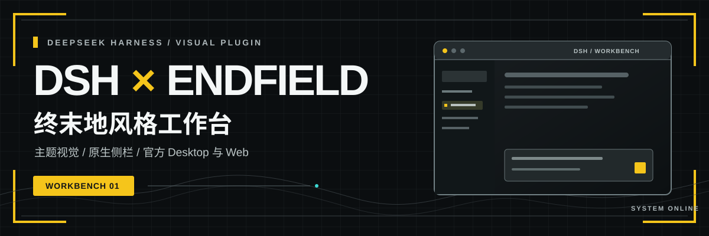

# DSH × 终末地风格工作台

<p align="center">
  
</p>

<p align="center">
  为 DeepSeek Harness 打造的终末地风格工作台插件<br />
  工业网格 · 等高线侧栏 · 原生右侧工作台
</p>

<p align="center">
  <a href="https://github.com/rison114514/dsh-endfield-ui/releases"></a>
  <a href="#快速开始"></a>
  <a href="#快速开始"></a>
  <a href="https://github.com/rison114514/dsh-endfield-ui/stargazers"></a>
</p>

<p align="center">
  <a href="https://github.com/rison114514/dsh-endfield-ui/releases">下载插件</a> ·
  <a href="#快速开始">安装指南</a> ·
  <a href="#功能一览">功能一览</a> ·
  <a href="#兼容说明">兼容说明</a> ·
  <a href="#合作推广">合作推广</a>
</p>

> **非官方同人主题**：本项目与游戏开发商及 DeepSeek 官方均无关联，不暗示合作或授权。

本项目通过 [DeepSeek Harness](https://github.com/deepseek-ai/deepseek-harness) 标准 Cordis Bundle 加载，不修改 DSH 核心文件。它适用于官方 macOS / Windows Desktop 和 Web；两个入口使用独立的插件 Profile。

## 功能一览

| 01 · 终末地视觉 | 02 · 原生工作台 | 03 · DSH 集成 |
| :--- | :--- | :--- |
| 工业网格、等高线侧栏、开屏与黄黑组件；适配浅色、深色和跟随系统外观。 | 右侧整合文件、编辑器、浏览器、终端、Git、任务与子代理。 | `OBJECTIVE` 与原生 Goal 共用状态；图片附件使用官方 Vision 链路。 |

## 快速开始

最新**正式发布版**为 `v1.1.0`，可从 [GitHub Releases](https://github.com/rison114514/dsh-endfield-ui/releases) 下载插件包。先安装并启动一次官方 DeepSeek Harness Desktop，再完全退出应用；Windows 还需从系统托盘退出。在应用中通过“管理 dsh 命令…”注册官方 CLI，然后在插件包所在目录执行：

```bash
dsh plugin --profile desktop add dsh-better-sidebar@0.24.1 ./rison-dsh-endfield-ui-1.1.0.tgz
```

重新打开 Desktop 即可使用。Web 入口单独安装：

```bash
dsh plugin --profile web add dsh-better-sidebar@0.24.1 ./rison-dsh-endfield-ui-1.1.0.tgz
dsh web
```

### 兼容说明

| 项目 | `v1.1.0` 正式版基线 |
| --- | --- |
| DeepSeek Harness | `0.2.0-rc.2` |
| Node.js | `>=22.19.0` |
| dsh-better-sidebar | `0.24.1` |

> [!WARNING]
> DSH `0.2.1` 用户请勿安装上述 `1.1.0` 组合。旧版侧栏的 Host 依赖已不兼容，文件区可能出现 HTTP 405。兼容修订尚未正式发布，请以 [Releases](https://github.com/rison114514/dsh-endfield-ui/releases) 的说明为准。

官方 Desktop 使用独立的 `desktop` Profile；普通 npm 全局安装的旧版 `dsh` 不一定能管理它。安装或卸载插件不会删除用户的会话、模型与设置。卸载命令：

```bash
dsh plugin --profile desktop remove @rison/dsh-endfield-ui dsh-better-sidebar
```

Web 用户将 `desktop` 改为 `web`。

## 合作推广

> 以下为 **RunningHub API 商业推广**。宣传图片及其中的产品、价格和性能信息由合作方提供；实际服务内容以 RunningHub 官方页面为准。本合作不代表 RunningHub 参与本项目开发。

<p align="center">
  <a href="https://www.runninghub.ai/call-api?source=github">
    
  </a>
</p>

RunningHub API 提供模型与工作流 API 服务。可通过[官方 API 页面](https://www.runninghub.ai/call-api?source=github)了解接入方式和免费测试；合作方提供的[完整宣传卡片](./assets/sponsors/runninghub/api-details.png)列有更多介绍。

## 项目说明

- 从 `v1.1.0` 起，GitHub Release 只提供插件 `.tgz`。仓库中的 `desktop-app/` 保留为历史实现参考，不再维护独立的 Electron 安装器。
- 内嵌浏览器受目标网站的 CSP 与 `X-Frame-Options` 限制，必要时可用外部浏览器打开。
- `dsh-shikitor@1.0.2` 不兼容 DSH 0.2；`v1.1.0` 使用 DSH 原生输入和补全能力。

维护与兼容细节见 [HANDOFF.md](./HANDOFF.md)，正式版本变更见 [RELEASE.md](./RELEASE.md)。
